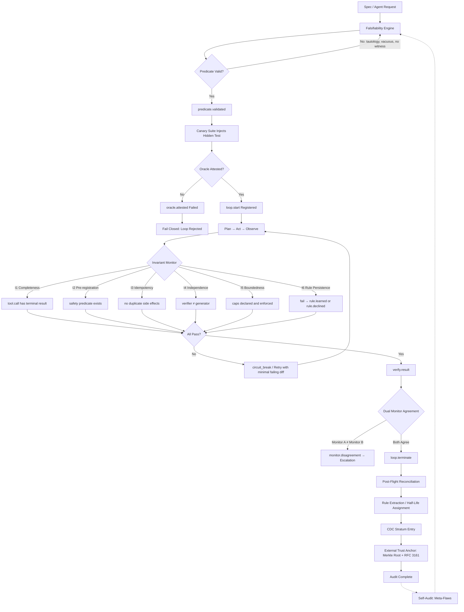
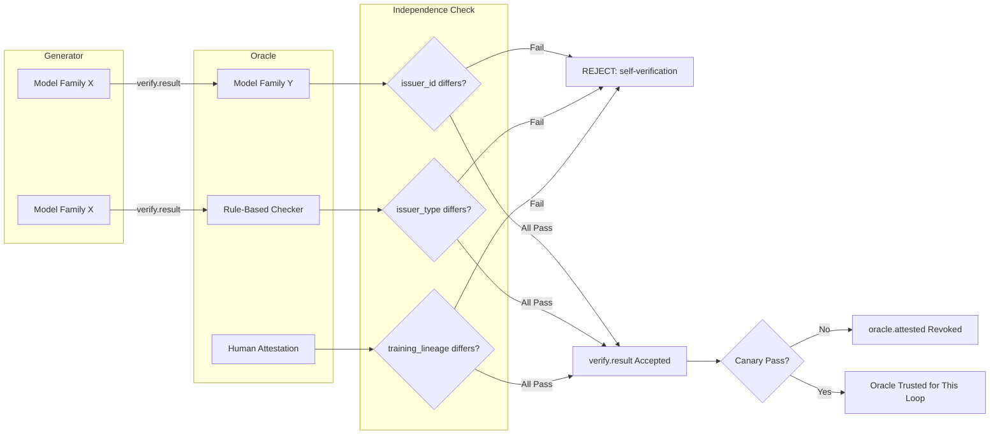

The Auditable Auditor

A Technical Article on the Boy Scouts Loop Audit System v2.0

---

Most agent audits fail the same way most agent loops fail. The definition of "done" is vague, the verifier is the generator, and the audit trail is a story the system tells about itself. v2.0 inverts that. The auditor is made auditable. Every invariant resolves to a schema field. Every schema field is exercised by a test. Every test has a named oracle. And the changelog refuses to lie about time.

This article describes the system end to end: its doctrine, its architecture, its loop, and the one assumption it names rather than hides.

---

1. Thesis

Agent loops rarely stall because the model lacks capability. They stall because "done" was never defined in a way that could fail. A falsifiable check, written before execution, is the cheapest possible definition of done — and it is the whole foundation.

The system rests on five principles that survive contact with a stressed operator:

Principle Technical Control
Be Prepared A falsifiable check is registered before execution and validated by an independent Falsifiability Engine — not self-declared.
Buddy System Verification independence is three-dimensional: issuer identity, issuer type, and training lineage. The oracle is itself audited.
Leave No Trace Every model call, tool call, retry, mutation, verification, and monitor assertion is appended to a tamper-evident log with an external trust anchor.
Do a Good Turn Daily Every failure becomes a persistent rule; every rule carries a half-life and must be re-proven or retired.
Fail Closed Null caps are a schema violation, not a policy choice. Unavailable trust anchor halts the pipeline.

Each principle maps to a control that can be tested. None of them reduce to "prompt the model better."

---

2. Architecture

The specification is packaged as interlocking artifacts, each closing a specific defect class:

Artifact Function Defect Closed
SCHEMA.md Full event taxonomy, null caps forbidden Schema–invariant drift
INVARIANTS.md I1–I6 + M1–M5 with negative tests Query bugs
META_AUDIT.md Meta-flaw register + recursion termination Auditor unaudited
FALSIFIABILITY_ENGINE.md Independent predicate analyzer Self-declared falsifiability
CANARY_SUITE.md Hidden rotating canary protocol Oracle blind spot
DUAL_MONITOR.md Agreement / disagreement protocol Monitor compromise
TRUST_ANCHOR.md Merkle root + RFC 3161 + fail-closed No external anchor
AUDIT_PROCEDURE.md Schema-bound pre/in/post-flight Procedure not executable
ACCEPTANCE_TESTS_v2.md Full matrix Coverage gaps
CDC.md Carbon-Dating Changelog Unreliable provenance

The point of the table is that no artifact is a document for its own sake. Each one exists because a specific failure mode was identified, and each one has a test that proves it works.

---

3. The Audit Loop

The loop is self-similar. The audit of the audit uses the same falsifiability engine, the same canary suite, and the same dual-monitor protocol. The recursion terminates at an external transparency log plus a named human oversight committee — the only base case that is not itself an agent.

That termination matters. An audit system that audits itself forever is not rigorous; it is stuck. The base case is stated, owned, and outside the agent.

---

4. Verification Independence

The Buddy System is not a suggestion. It is invariant I4, enforced across three dimensions:

A model verifying itself with a different identifier but the same training lineage fails I4 and is rejected. Identity alone is not independence. Two models from the same family may share the same blind spots; a rule-based checker or a human attestation closes the gap that lineage diversity cannot.

---

5. Fail-Closed Enforcement

The system has exactly one default when anything is uncertain: halt.

Condition Action
Predicate unvalidated loop.start never accepted
Oracle canary fails oracle.attested revoked
Single monitor emits circuit_break Requires second monitor attestation or explicit monitor.disagreement record
Trust anchor unavailable Halt — no stratum entry is written
Caps undeclared (null) Schema violation at loop.start
Rule expired beyond 2×T½ May not be cited as justification; must be revalidated or retired

Fail-closed is the least popular principle and the most important one. Every alternative — proceed on uncertainty, log the anomaly, fix it later — converts a detectable failure into a silent one.

---

6. Analytics: The Carbon-Dating Changelog

The changelog is not a timestamp column. It is a stratigraphic, multi-source, decay-aware provenance system that dates changes the way radiocarbon dating dates strata — because clocks lie, causality does not.

6.1 Stratigraphic Ordering

Every release is a numbered stratum L0 … Ln. Every entry declares parent_hash, so ordering is derivable even if every clock is wrong. This is relative dating: causality beats chronology.

6.2 Isotope Concordance

Every change carries ≥3 independent time sources:

1. Monotonic host clock
2. Signed external timestamp authority (RFC 3161)
3. Transparency-log inclusion proof
4. Signed version-control commit

Concordance rule: all sources must agree within tolerance Δ. Discordance action: quarantine the change into an undateable stratum. Do not merge. Do not backfill. An undateable change is an explicit gap in the changelog, never a silent correction.

6.3 Half-Life and Decay

Every rule and mitigation gets a half-life T½. Re-validation is due at T½ and mandatory by 2·T½. Beyond 2·T½ the rule is decayed: it may not be cited and must be re-proven or retired.

This is the quiet failure mode of most audit systems. A control written once is assumed to hold forever. The decay model converts "we wrote a rule" into "we can still defend this rule today."

6.4 Contamination Ratios

The changelog tracks and thresholds three ratios:

· Human-authored vs agent-authored changes
· Test-first vs test-after (doctrine requires test-first; a stratum violating this is flagged)
· Reverted-change ratio

A stratum that fails a ratio threshold is flagged in the changelog itself. The audit of the changelog is part of the changelog.

---

7. The Open Assumption

The system's self-audit names the single critical assumption that, if false, invalidates the whole stack:

The external trust anchor is not controlled by the same adversary that can write the local log.

If one adversary controls both the local log and the external anchor, no amount of Merkle-rooting or timestamping recovers integrity. This is the boundary of the system's guarantee, stated explicitly rather than buried.

Naming the assumption is not a weakness. An audit system that claims no boundary is either naive or dishonest. The boundary is where oversight becomes human again.

---

8. Conclusion

The Boy Scouts Loop Audit System v2.0 does not claim to prove agent correctness. It claims something narrower and more useful: every claim the system makes about itself is backed by a check that can fail, and every failure is converted into a durable, decaying rule.

The auditor is auditable. The changelog refuses to lie about time. The loop terminates — or it fails closed.

That is the whole contract.

Be Prepared. Verify Independently. Leave No Trace. Learn from Every Failure. Fail Closed.
